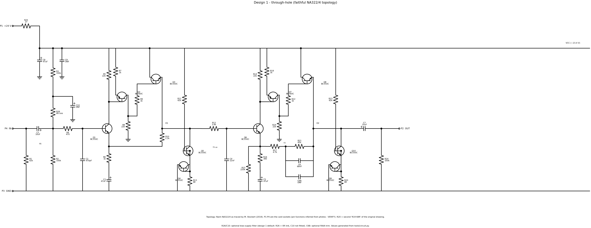
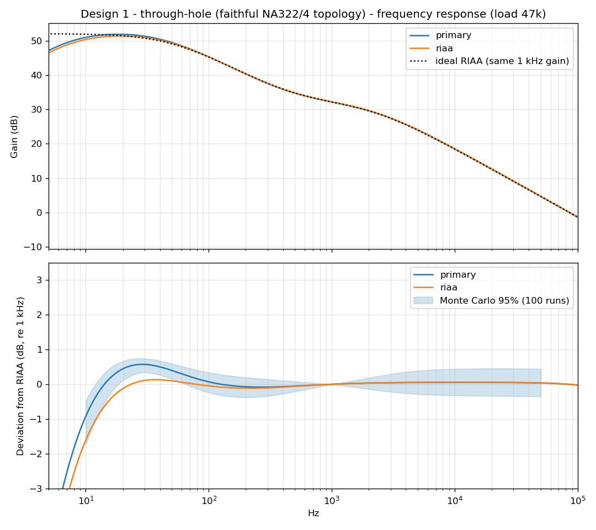
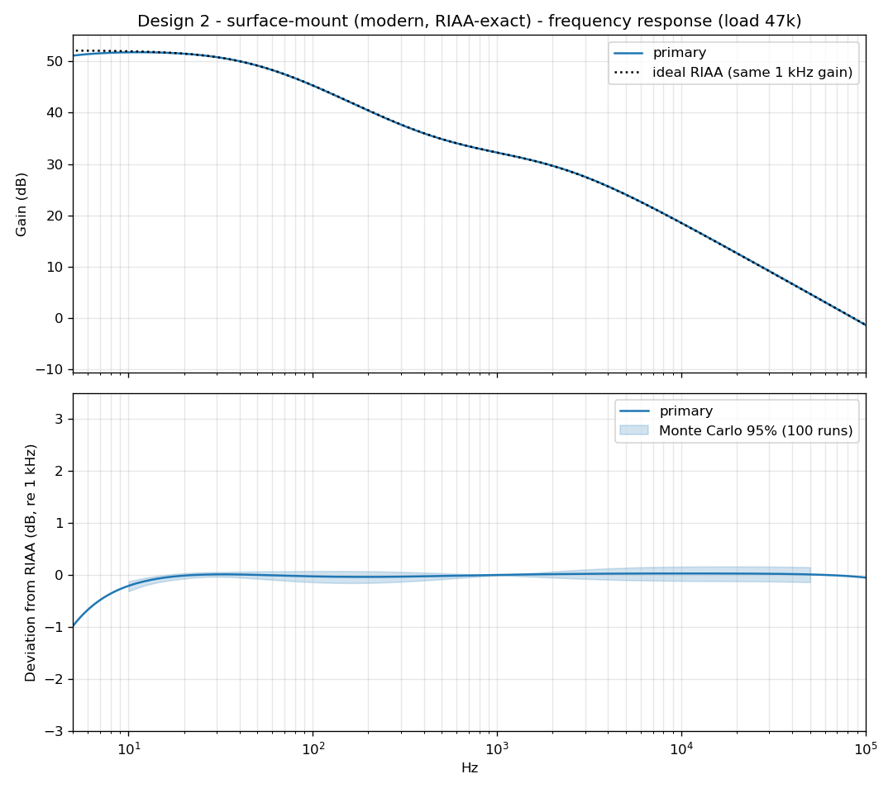
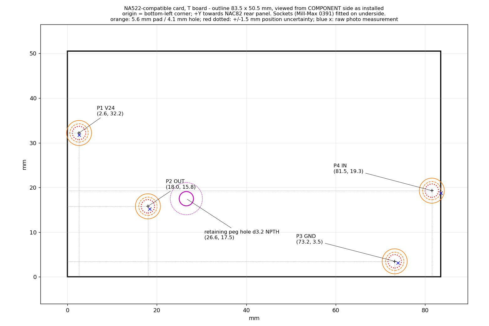
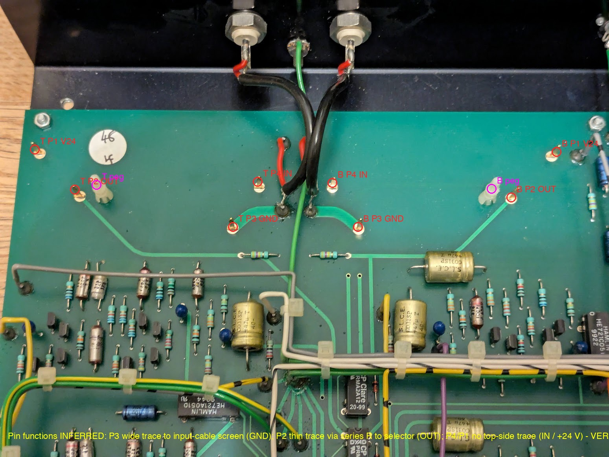
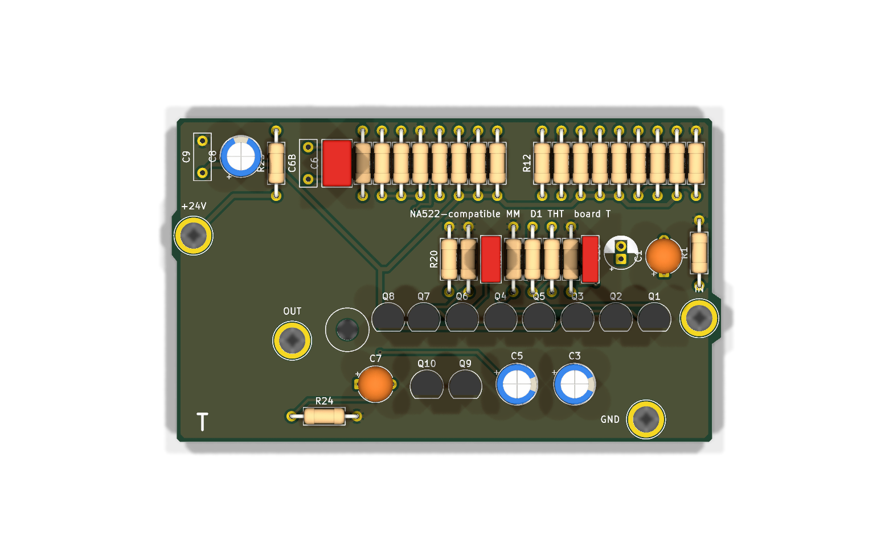
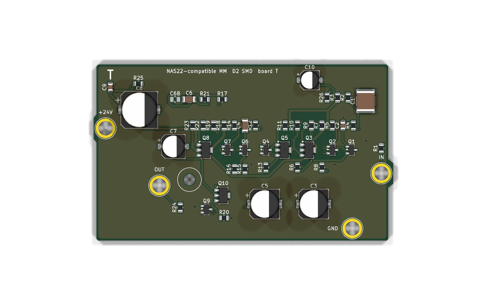

# NA522-compatible MM phono cards for the Naim NAC82: design document

**Status:** Rev A, proposed for engineering review. Nothing has been built or measured yet. Every figure here comes from simulation or from photographs.
**Date:** 12 Nov 2026
**Scope:** Two plug-in MM phono cards, electrically and mechanically compatible with the NA522 slot in the NAC82:
- **Design 1:** through-hole, faithful to the original circuit. See [`design1_tht/`](design1_tht/README.md).
- **Design 2:** surface-mount, a "modern equivalent" with precision parts and corrected RIAA. See [`design2_smd/`](design2_smd/README.md).

---

## 1. Summary for the reviewer

| | Design 1 (THT, faithful) | Design 2 (SMD, modern) |
|---|---|---|
| Topology | Naim NA322/4 as traced: 2 discrete stages, 10 BJTs, passive 75 µs + active 3180/318 µs | Same |
| Gain @1 kHz | 32.2 dB | 32.2 dB |
| RIAA error 20 Hz–20 kHz (nominal / MC 95 %) | 0.57 dB / 0.73 dB (intentional? see §5.1) | **0.04 dB / 0.16 dB** |
| Input load | 44.7 kΩ + ≈470 pF | 44.2 kΩ + ≈470 pF |
| SNR re 5 mV, A-wtd (shorted / 1 k + 500 mH) | 83 / 78 dB | 84 / 78 dB |
| THD @1 kHz, 5 mV / 50 mV in | 0.0065 % / 0.053 % | 0.0065 % / 0.053 % |
| Overload @1 kHz (1 % THD) | 181 mV (31 dB margin) | 184 mV |
| PSRR @100 Hz (P1 → OUT) | −19.5 dB | **−46 dB** |
| Supply | 20.4 mA from +24 V | 20.2 mA from +24 V |
| PCB | 2-layer 83.5 × 50.5 mm, T and B mirror boards, DRC-clean, fully routed | Same |

**Key risks to review first (detail in §10):**
1. The pin functions and positions of the NAC82 slot are inferred from photographs. They must be verified with a meter and callipers before anything is plugged in.
2. **The cards in the supplied photographs are marked NA523/1, which is Naim's MC board, not the NA522 MM board** (§3). The mechanical data was taken from them, since both use the same slot. The electrical design is the MM NA322/4 circuit.
3. The NA322/4 schematic is itself a third-party reverse-engineering (Stockert 2019), not a Naim document.
4. The socket choice (Mill-Max 0391) is plausible on paper but untested on the real blade pins.

---

## 2. Sources

| # | Source | Used for |
|---|---|---|
| S1 | `NAIM NA 322-4.pdf` (this folder): M. Stockert, *NAIM NA 322/4 MM phono board*, schematic + layout, updated 4 Jan 2019. Online: <https://www.diyaudio.com/community/attachments/naim-na-322-4-updated-pdf.726559/>; earlier version: <https://www.diyaudio.com/community/attachments/naim-na-322-4-pdf.719013/> | Circuit topology and values |
| S2 | diyAudio thread "Naim NA322 MM phono board" (Stockert; traced from photos, no factory schematic): <https://www.diyaudio.com/community/threads/naim-na322-mm-phono-board.330551/> | Provenance of S1 |
| S3 | Naim community FAQ, "Naim NA3xx and NA5xx pre-amplifier daughter boards": <https://community.naimaudio.com/t/naim-na3xx-and-na5xx-pre-amplifier-daughter-boards/915> | NA522 = MM, NA523 = MC (S/K/E); NA5xx boards lie flat and fit NAC52/82/92/102/NAIT3; NA3xx and NA5xx differ "mainly in the way they fit" |
| S4 | "NAC 82 phono card": <https://community.naimaudio.com/t/nac-82-phono-card/11296> | NA523/1 = 1st issue, S variant; retaining clip; Stageline is "based on the interchangeable boards" |
| S5 | "Fitting NA522": <https://community.naimaudio.com/t/fitting-na522/12760> | Boards are handed ("NT"/"NB" stickers, fit only one way); motorboating if links are not cut on an unequipped NAC92 |
| S6 | "Install phono boards on Naim 52 preamp": <https://community.naimaudio.com/t/install-phono-boards-on-naim-52-preamp/11794>; "NAC 82 fitting phono boards": <https://community.naimaudio.com/t/nac-82-fitting-phono-boards/1270> | Mounting, T/B marking caveats, motherboard links |
| S7 | NA523 variants: <https://community.naimaudio.com/t/na523-2-boards/19196>, <https://community.naimaudio.com/t/323-e-phono-boards/11198> | MC loading (470 Ω S, 560 Ω K/E) |
| S8 | NAC82 specification, hifidatabase: <https://www.hifidatabase.com/Naim_NAC%2082_4831.php> | MM 2 mV / 47 kΩ; line 75 mV; 40 dB overload margin claim |
| S9 | HiFi News review of NAC82/NAP180: <https://www.hifinews.com/content/naim-nac-82nap-180-prepower-amps> | 24 V rails from the power amp / Hi-Cap |
| S10 | Factory Naim schematics of sibling boards (NA321, NA324): <http://ukhhsoc.torrens.org/makers/Naim/Schematics/index.html> | Corroborates S1's building blocks: 27R/47 µF supply filter, 330k/330k bias, 470R + 470 pF input, 68R current sinks, 10 µF + 100k output, ZTX384C/ZTX214C transistors |
| S11 | Pink Fish Media "A DIY Naim 522 board": <https://pinkfishmedia.net/forum/threads/a-diy-naim-522-board.162260/> | No NA522 schematic found publicly |
| S12 | Mill-Max 0391-0-15-15-07-27-10-0: <https://www.mill-max.com/products/pin-receptacle/receptacle-with-no-tail/0391/0391-0-15-15-07-27-10-0>; contact/mating-pin notes: <https://www.mill-max.com/engineering-notebooks/pin-receptacles/the-contact-clip-the-heart-of-the-mill-max-receptacle>, <https://www.mill-max.com/engineering-notebooks/pin-receptacles/understanding-mating-pins-ranges-and-forces> | Socket for the 0.8 × 1.7 mm blade (1.88 mm diagonal, #07 contact 1.65–2.08 mm, 4.09 mm hole) |
| S13 | User photographs `PXL_20261112_*.jpg` (this folder) | Mechanical positions, pin-function inference, board marking |

Some forum pages (Pink Fish Media, parts of diyAudio) could not be read by the automated research and are cited from titles or snippets only. The facts that matter most are S3–S5, which were read in full.

---

## 3. What the boards are

- **NA5xx family:** flat daughter cards with sockets on the underside.
  - NA522 = MM ("N").
  - NA523 S/K/E = MC.
  - NA526 = link board.
  - NA528 = variable sensitivity.
  
  The NA3xx boards are the same circuits in a vertical format for NAC32.5/62/72 etc. (S3).
- **The photographed cards are marked "NA523/1"**, with T/B silkscreen letters. By S3/S4 these are first-issue **MC** cards.
  - They contain about 13 transistors and a diode, against 10 transistors in the NA322/4 MM circuit.
  - **The MC circuit was not reverse-engineered here.** The electrical design follows the MM NA322/4 trace (S1), as requested.
  - Physically the NA522 and NA523 occupy the same slot. The photos were used only for the outline, the socket and peg positions, and the pin functions.
  - If the amplifier is to keep an MC cartridge, these designs are not a replacement.
- **NA322 vs NA522 circuit.** S3 says the 3xx and 5xx boards differ mainly in how they fit. A dealer listing calls the NA522 close to the Stageline N, and Naim (S4) says Stageline is based on the cards. S10 confirms the shared building blocks.
  - **No NA522 schematic exists in the public domain.** That the circuits are identical is a strong inference, not a fact.
  - A trace of a real NA522 would close this gap (§10, R2).
- **Handedness.** The two cards are mirror images: the sockets and peg are mirrored about the board's vertical axis (S5 and our measurements, §6). Two PCBs are therefore produced per design: **T** (left channel position in the photo) and **B**.

---

## 4. The circuit (NA322/4, as traced in S1)

Schematic: [`design1_tht/schematic/na522_tht_schematic.pdf`](design1_tht/schematic/na522_tht_schematic.pdf) (Design 2: [`design2_smd/schematic/`](design2_smd/schematic/)).
Machine-readable netlist (single source of truth): [`tools/circuit.py`](tools/circuit.py).



### 4.1 Stages

- **Supply.**
  - +24 V (P1) feeds VCC through R25 27 Ω, decoupled by C8 47 µF.
  - VCC ≈ 23.45 V at 20.4 mA.
  - About 18.5 mA of that is the two ≈9.3 mA current sinks.
- **Input.**
  - R1 62 k loads the cartridge before C1.
  - C1 10 µF couples into the bias node B1 (R3/R2 330 k/330 k from VCC, so ≈11.7 V).
  - R4 470 Ω + C2 470 pF form an RF filter (720 kHz). **C2 also appears as ≈470 pF of cartridge loading in the audio band.**
  - Zin = 62 k ∥ 165 k ≈ 45 k, which matches Naim's 47 kΩ spec (S8).
- **Stage 1: flat gain.**
  - Q1 (NPN, Ic ≈ 55 µA) drives Q2 (PNP, 0.55 mA, R7 emitter degeneration, R8 load).
  - Q2 drives follower Q3, which is loaded by the Q5/Q4 current sink (≈0.63 V / R13 68 Ω = 9.3 mA).
  - Series feedback: R10 2k2 to Q1's emitter, R6 1 k + C3 47 µF to ground. Gain is 1 + R10/R6 = 3.2 (10.1 dB), with DC gain of unity.
- **Passive 75 µs pole.** R12 3k4 1 %/50 ppm × C4 22 nF = 74.8 µs.
- **Stage 2: RIAA bass.**
  - Same transistor topology (Q6/Q7/Q8, sink Q10/Q9).
  - Feedback is R17 4k7 + (R21 82 k ∥ C6 68 nF) to Q6's emitter, which is grounded through R16 390 Ω + C5 47 µF.
  - R15 220 k sets DC.
  - The stage gives the 3180/318 µs shelf, plus a sub-sonic roll-off from C5.
- **Output.** C7 10 µF couples O2 (≈10 V DC) to P2. R24 100 k is the bleed.
- **Naming.** S1 labels two parts "R19". The 68 Ω sink resistor is called **R20** here.
- **New positions** (inactive in Design 1, used in Design 2):
  - R26 + C10: bias-supply filter.
  - C6B: RIAA trim, in parallel with C6.
  - C9: HF supply bypass.

### 4.2 DC operating point (Design 1, simulated)

| Node | V | | Device | Ic | Vce | Pd |
|---|---|---|---|---|---|---|
| VCC | 23.45 | | Q1 / Q6 | 55 / 53 µA | 11.1 / 11.9 V | <1 mW |
| B1 | 11.71 | | Q2 / Q7 (PNP) | 0.55 / 0.50 mA | 11.2 / 12.2 V | 6 mW |
| O1 | 11.00 | | Q3 / Q8 (followers) | 9.2 / 9.3 mA | 12.4 / 13.5 V | 115 / 125 mW |
| O2 | 9.97 | | Q5 / Q10 (sinks) | 9.3 / 9.3 mA | 10.4 / 9.3 V | 96 / 87 mW |
| Z1, Z2 | 0.63 | | Q4 / Q9 (clamps) | 0.34 mA | 1.4 V | <1 mW |

Over 0–60 °C, O2 moves from 9.6 to 10.4 V and the supply current from 21.8 to 18.7 mA. The full tables are in `simulation/RESULTS.md`.

---

## 5. Analysis findings

### 5.1 RIAA accuracy: an ideal-op-amp analysis is misleading

- **Ideal-gain prediction.** Treating each stage as an ideal non-inverting amplifier, the traced values give a pole at R21·C6 = 5.58 ms instead of 3.18 ms, which predicts **+2.75 dB at 20 Hz**. (`work/analysis/ideal.py` is the scratch calculation.)
- **Transistor-level result.** The stage-2 loop gain at low frequencies is only a few, so the transistor-level circuit (ngspice) is much closer to RIAA:
  - +0.44 dB @20 Hz
  - +0.40 dB @50 Hz
  - +0.07 dB @100 Hz
  - ≤0.05 dB from 1 kHz to 20 kHz
- **So R21 = 82 k is consistent with Naim compensating for the finite open-loop gain.** It is not a trace error. A residual bass lift of ≈+0.4 dB from 20 to 60 Hz remains, and may be deliberate voicing.
- **Corrected values.** Optimising R21/R17 inside the SPICE loop (`tools/optimise_riaa.py`) gives:
  - Design 1 option 'riaa': R21 73.2 k, R17 4.75 k → 0.13 dB.
  - Design 2: R21 63.4 k with C5 220 µF → 0.04 dB.
- **Robustness.** The result hardly moves when hFE is scaled by 0.7–1.4×, so it is not fragile.
- **Model dependence.** The result does depend on the transistor models' gm/re behaviour. **A reviewer should re-run with vendor models** (§10, R6).




### 5.2 Gain and level matching

Both designs give 32.2 dB at 1 kHz. 2 mV in gives ≈81 mV out, which matches the NAC82 line sensitivity of 75 mV (S8). Design 2 keeps the gain within 0.05 dB of Design 1, so the two can be mixed between channels.

### 5.3 Noise

Simulated: EIN ≈ 5.9 nV/√Hz @1 kHz (D1) and 5.3 nV/√Hz (D2). Design 2 halves the impedance of the stage-1 feedback network. Q1 runs at only ≈55 µA (re ≈ 470 Ω), and its noise together with R4, R6 and R10 dominates.

| | Design 1 | Design 2 |
|---|---|---|
| A-weighted SNR re 5 mV, shorted input | 83.1 dB | 84.0 dB |
| A-weighted SNR re 5 mV, with a 1 k + 500 mH cartridge | 77.8 dB | 78.1 dB |

The cartridge's own impedance noise dominates in practice.

### 5.4 Supply rejection

- **The weak point of the original.** With only R25 27 Ω / C8 47 µF (a 125 Hz corner), ripple at P1 reaches OUT at **−19.5 dB @100 Hz**.
- **Mechanism.** The dominant path is stage 2: Q6's Vce follows VCC (its load R14 returns to VCC), the Early effect turns that into a current, and the stage's bass gain amplifies it. The R3 bias path adds to this.
- **Naim relies on a well-regulated 24 V.** Design 1 keeps that behaviour.
- **Design 2's fix** adds the R3/R26/C10 bias filter and a 68 Ω / 470 µF supply filter, giving **−46 dB**. The cost is 0.8 V less VCC. Headroom is unchanged within 0.3 dB.

### 5.5 Overload and headroom

| Frequency | Overload (1 % THD) | Limit |
|---|---|---|
| 1 kHz | ≈180 mV in | The O2 output swing (≈7.3 V rms) |
| 20 Hz | ≈12 mV in (+19 dB RIAA bass gain) | — |
| 20 kHz | ≈1.7 V in | — |

The 1 kHz figure is 31 dB above 5 mV. That is below Naim's claimed 40 dB (S8), but that claim may refer to the whole preamp at nominal sensitivity, i.e. 2 mV, where the margin is 39 dB. **This is consistent.**

### 5.6 Power-up transient

At switch-on, O2 swings towards VCC before C5 and C3 charge. In both designs this puts **≈+20 V for ~0.2 s at OUT** into 47 kΩ, then the output settles within 50 mV in about 6 s (D1) or 13 s (D2, larger capacitors). The behaviour is inherent to the original topology, so the NAC82 presumably copes (muting or level). It still needs confirming (§10, R8). See `simulation/powerup.png`.

### 5.7 Thermal

- The followers and sinks dissipate 85–125 mW each.
- TO-92 (D1, BC550C, 500 mW rated) runs at about +25 °C rise.
- In D2 these four devices are BCX56 in SOT-89. SOT-23 would have run at about +60 °C.

---

## 6. Mechanical

### 6.1 Method

- **Board outline:** 83.5 × 50.5 mm (from the brief).
- **Positions:** socket and peg positions were measured on the underside photograph `PXL_20261112_171350076.jpg`, using a 4-point perspective (homography) correction from the board corners to 83.5 × 50.5 mm, for both cards independently.
- **Mirror check.** Mirroring the B card's measurements reproduces the T card's within 0.1–1.5 mm. The worst case is P4 X at 2.5 mm, where the T card's right edge is poorly defined in the photo, so the B value was used there.
- **Orientation check.** The orientation and the T/B assignment were confirmed against the pin pattern on the motherboard photo `PXL_20261112_171250260.jpg`.
- **Note:** turning the pair over for the underside photo swapped them, so the photo's right-hand card is T.

Script: [`tools/mechanical.py`](tools/mechanical.py). Annotated photographs: [`common/mechanical/annotated_underside_photo.jpg`](common/mechanical/annotated_underside_photo.jpg) and [`annotated_motherboard_pins.jpg`](common/mechanical/annotated_motherboard_pins.jpg). Dimensioned drawings: [`mechanical_T.pdf`](common/mechanical/mechanical_T.pdf), [`mechanical_B.pdf`](common/mechanical/mechanical_B.pdf). Table: [`connector_positions.csv`](common/mechanical/connector_positions.csv).

### 6.2 Positions used

The frame is the component side as installed, origin at the bottom-left corner, +Y towards the rear panel. The estimated uncertainty is **±1.5 mm**.

| Item | Function (inferred) | T board X, Y (mm) | B board X, Y (mm) | Evidence for the function |
|---|---|---|---|---|
| P1 | +24 V | 2.6, 32.2 | 80.9, 32.2 | No top-side motherboard trace; outer corner pin |
| P2 | OUT | 18.0, 15.8 | 65.5, 15.8 | Thin motherboard trace via a series resistor to the input selector |
| P3 | GND | 73.2, 3.5 | 10.3, 3.5 | Wide trace to the input-cable screen pad; sits in the card's large copper pour |
| P4 | IN | 81.5, 19.3 | 2.0, 19.3 | Adjacent to the input cable's inner (red) conductor landing; centre pins |
| Peg hole | Retaining snap peg | 26.6, 17.5 (Ø3.2) | 56.9, 17.5 | Plastic peg visible on the motherboard next to P2 |




### 6.3 Sockets and outline "ears"

- **Socket.** The NAC82 pins are 0.8 × 1.7 mm blades. The nearest catalogue receptacle found is the **Mill-Max 0391-0-15-15-07-27-10-0** (S12): #07 4-finger contact for 1.65–2.08 mm (the blade diagonal is 1.88 mm), gold, closed bottom, recommended hole 4.09 mm. It is fitted from the underside.
- **Footprint:** 4.1 mm plated hole, 5.6 mm pad (`common/kicad_lib/NA5xx.pretty`).
- **Edge clearance.** The original stamped sockets are small and sit only ~2–2.6 mm from the edge at P1 and P4, overhanging it in the photograph. A 5.6 mm pad cannot fit there. The outline therefore has two small **ears**, 0.8 mm at P1 and 1.4 mm at P4. **Check that nothing in the NAC82 fouls these.** If anything does, the alternatives are:
  - salvage the original sockets;
  - a smaller custom pad, accepting a thin annulus;
  - a different receptacle.
- **Retention and wipe.** A round 4-finger clip only touches the blade's edges. Retention and cycle life are untested.

### 6.4 Height

- The cards plug down onto the pins; the snap peg sets the stand-off.
- Tallest parts:
  - D1: 11 mm (6.3 × 11 electrolytics).
  - D2: 10.2 mm (8 × 10 / 10 × 10 SMD electrolytics).
- The originals carry 47 µF axial cans about 10 mm in diameter, so the envelope should be similar. **Verify against the lid.**

---

## 7. Design 1: through-hole (faithful)

See [`design1_tht/README.md`](design1_tht/README.md).

- **Values:** the original values with modern equivalents:
  - BC550C/BC560C for ZTX384C/ZTX214C;
  - polypropylene film for polystyrene and polyester;
  - KEMET tantalum for C1/C7, as the original;
  - Panasonic FR 47 µF/50 V for the obsolete S.L.C.E. CO31SP cans.
- **Option positions** (inactive by default):
  - R26 (0 Ω link) / C10 for the bias filter;
  - C6B for an RIAA trim;
  - C9 for an HF bypass.
- **Value option 'riaa'** (R21 73.2 k, R17 4.75 k) for a flat response.



## 8. Design 2: surface-mount (modern equivalent)

See [`design2_smd/README.md`](design2_smd/README.md) for the full table of changes and their rationale.

- **Topology:** the same, deliberately: it preserves the gain, input loading, output DC conditions and Naim's character.
- **Changes from the original:**
  - RIAA corrected to ±0.04 dB;
  - 0.1 %/25 ppm thin-film resistors;
  - C0G RIAA capacitors;
  - no tantalum;
  - lower-noise stage-1 feedback;
  - +26 dB PSRR;
  - SOT-89 power devices.



### Alternatives considered

- **An op-amp design** (e.g. OPA1656 / OPA1612 on a 12 V virtual ground) would have:
  - lower distortion (<0.001 %);
  - RIAA set purely by passives;
  - a simpler BOM.

  It was **not chosen** for the primary design. It would change the circuit's character, its start-up behaviour and its output impedance, and the brief asks for a "modern equivalent of the original board". It is a reasonable Rev B if the reviewer prefers it.

- **A capacitance-multiplier supply filter** would give more PSRR. It was not chosen because the RC filter already reaches −46 dB.

---

## 9. Verification performed

| Check | Result | Where |
|---|---|---|
| SPICE OP, AC, noise, THD (FFT, fade-in source), overload search, Zin/Zout, PSRR, power-up, 0/27/60 °C, Monte Carlo (100 runs incl. hFE) | See tables above | `design*/simulation/RESULTS.md`, `results.json`, `netlists/` |
| Capacitor DC voltage vs rating, polarity | All within rating; no reverse bias; max 65 % (D2 C8) | `design*/bom/BOM.md` "DC check" column |
| PCB DRC (KiCad 10.0.8) | 0 errors, 0 unconnected, all 4 boards. Warnings: silk overlaps; "library not found" (global fp-lib-table not configured on the build machine) | `design*/pcb_*/drc_report.json` |
| Pad-to-net check of every footprint against `circuit.py` (incl. transistor C/B/E mapping) | All OK | `common/pcb_netlist_verification.txt` |
| T/B mirror consistency of mechanical measurements | 0.1–1.5 mm (P4 X: 2.5 mm) | `common/mechanical/connector_positions.csv` |

---

## 10. Open issues: reviewer checklist

| # | Item | Why it matters | Suggested action |
|---|---|---|---|
| R1 | **Slot pinout** (P1 +24 V, P2 OUT, P3 GND, P4 IN) inferred from photos | Wrong pinout puts 24 V on the input or the output | Meter checks in `common/TEST_PROCEDURE.md` §0 before fitting anything |
| R2 | NA522 = NA322/4 circuit is inferred (S3, S10). The photographed cards are NA523/1 (MC) | The topology or values may differ on a real NA522 | Trace or measure an NA522 if one can be borrowed; compare gain and RIAA with §5 |
| R3 | Socket positions ±1.5 mm | Cards won't plug in | Callipers on the motherboard; edit `tools/placement.py` and regenerate (minutes) |
| R4 | Mill-Max 0391 on 0.8 × 1.7 blades; the "ears" at P1/P4 | Retention, contact reliability, clearance | Order samples; test-fit; check the ears against neighbouring parts |
| R5 | Freerouting autorouted layout with GND pours on both layers | Grounding topology matters at MM levels | Review the input loop (P4–R1–C1–Q1–R6/C3–P3) and the return of the 9 mA sink currents; hand-tidy if desired. Any change to the layout passes through KiCad DRC |
| R6 | Transistor models are representative, not vendor | RIAA LF accuracy depends on gm/re; noise depends on rbb' | Re-run `tools/simulate.py` with Diotec/Nexperia models |
| R7 | Load presented by the NAC82 to P2 assumed to be 47 kΩ | LF corner of C7, output level | Measure; change `RLOAD` in `tools/simulate.py` |
| R8 | +20 V power-on transient at OUT (inherited) | Possible thump | Check NAC82 muting behaviour; measure with the original card for comparison |
| R9 | C2 = 470 pF cartridge loading (original) | Many MM cartridges want 100–200 pF in total | Voicing choice; C2 can be reduced to 100–220 pF without other changes (RF corner rises) |
| R10 | Bass lift of ≈+0.4 dB in Design 1 / original | Possibly part of the Naim "sound" | Decide between faithful and the 'riaa' option |
| R11 | Component heights vs lid; peg stand-off | Fit | Measure |
| R12 | Net classes: every track is 0.4 mm (the "Power" class did not propagate to Freerouting) | 20 mA only; acceptable | Optionally widen the supply tracks by hand |

---

## 11. Repository layout and regeneration

```
DESIGN.md                    this document
board.md                     original brief
NAIM NA 322-4.pdf, PXL_*.jpg source material
tools/                       circuit.py (netlist + values), simulate.py, optimise_riaa.py, build_pcb.py,
                             placement.py, draw_schematic.py, make_bom.py, mechanical.py, verify_pcb_netlist.py, models.lib
common/                      TEST_PROCEDURE.md, mechanical/, kicad_lib/NA5xx.pretty, pcb_netlist_verification.txt
design1_tht/, design2_smd/   README.md, schematic/, bom/, simulation/, pcb_T/, pcb_B/ (KiCad + Gerbers + drill + pos)
work/                        scratch (reference renders, tool downloads, Python venv); not a deliverable
```

**Toolchain:**
- KiCad 10.0.8, from `~/Applications/KiCad`.
- ngspice.
- Freerouting 2.5.0, with OpenJDK.
- Python 3.14 with numpy, matplotlib and schemdraw.

All artefacts regenerate from `tools/circuit.py` and `tools/placement.py`; see `design1_tht/README.md` for the commands. A value or position change takes minutes to propagate to the simulations, BOMs, schematics and Gerbers.
