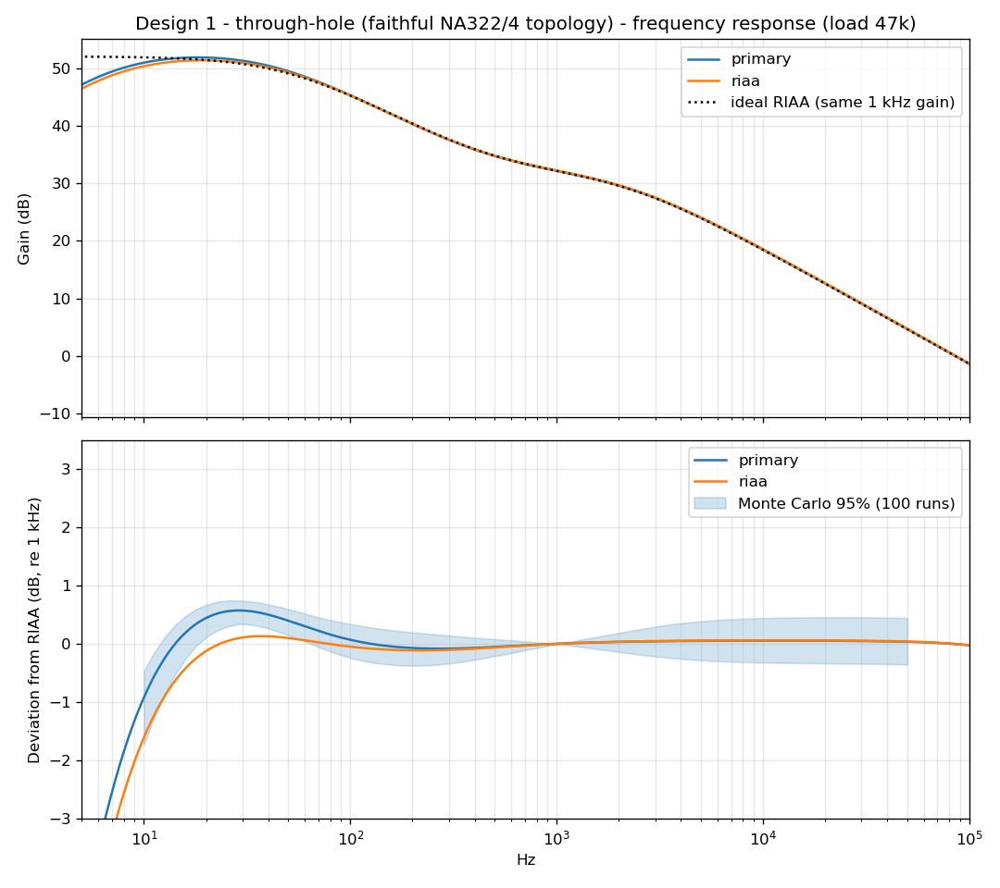
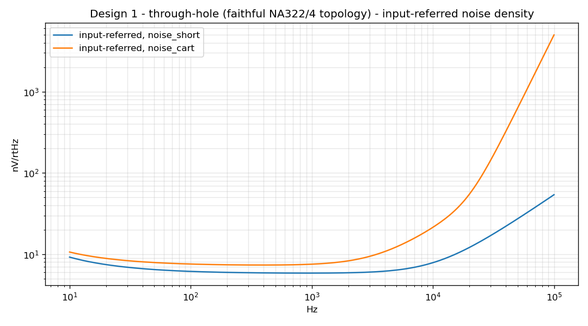
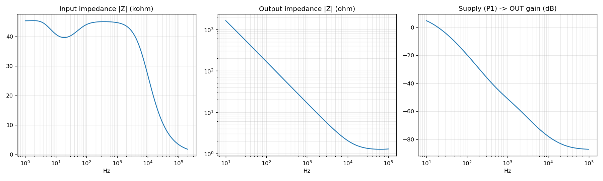
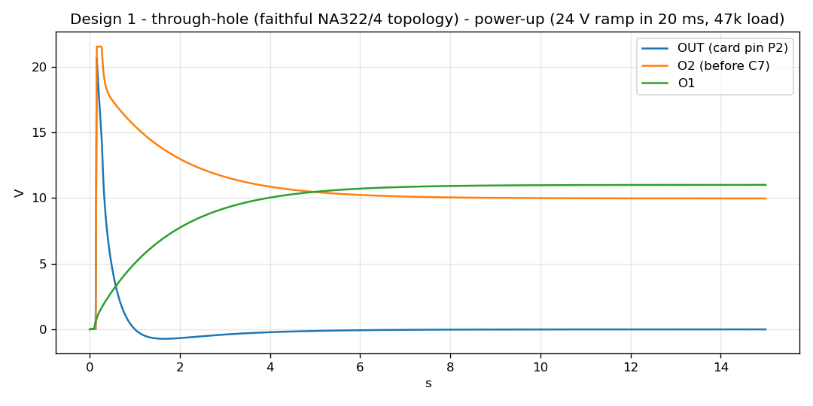

# Simulation results - Design 1 - through-hole (faithful NA322/4 topology)

Generated by `tools/simulate.py tht` (ngspice). All netlists are in `netlists/` and can be re-run with `ngspice -b <file>.cir` from that directory.

Assumptions: load 47 kohm on OUT (NAC82 selector input impedance not yet measured), cartridge 1000 ohm + 0.5 H, ideal 24 V at P1. Transistor models are representative, see `netlists/models.lib`.

## Headline figures

| Parameter | Value |
|---|---|
| Gain @ 1 kHz | 32.18 dB (x40.6) |
| RIAA deviation 20 Hz-20 kHz (max abs) | 0.57 dB |
| RIAA deviation 50 Hz-20 kHz (max abs) | 0.40 dB |
| Input impedance @1 kHz / 20 kHz | 44.7 k / 15.7 k |
| Output impedance @1 kHz | 16.6 ohm |
| Supply current | 20.4 mA |
| SNR re 5 mV @1 kHz, A-wtd, 1k+500mH source | 77.8 dB |
| SNR re 5 mV @1 kHz, A-wtd, shorted input | 83.1 dB |
| EIN @1 kHz, shorted input | 5.86 nV/rtHz |
| THD @1 kHz, 5 mV in | 0.0065 % |
| THD @1 kHz, 50 mV in | 0.0530 % |
| THD @20 kHz, 20 mV in | 0.0029 % |
| Overload (1 % THD) @20 Hz / 1 kHz / 20 kHz | 12.0 / 181 / 1735 mV rms |
| Overload margin re 5 mV @1 kHz | 31.2 dB |
| PSRR (P1 -> OUT) 100 Hz / 1 kHz / 10 kHz | -19.5 / -51.0 / -77.7 dB |
| Power-up: peak at OUT (47k load) / settles within 50 mV after | 20.66 V / 6.4 s |
| Monte Carlo (100 runs, R 1.0%, C 5%, electrolytic 20%, hFE x0.75..1.4): 95th pct max RIAA error | 0.73 dB |
| Monte Carlo gain spread @1 kHz | 31.99 .. 32.45 dB |

## Frequency response / RIAA deviation by value set

| Value set | Gain@1k | 10 Hz | 20 Hz | 50 Hz | 100 Hz | 10 kHz | 20 kHz | 50 kHz |
|---|---|---|---|---|---|---|---|---|
| primary | 32.18 dB | -0.92 | +0.44 | +0.40 | +0.07 | +0.05 | +0.05 | +0.03 |
| riaa | 32.25 dB | -1.61 | -0.13 | +0.10 | -0.05 | +0.06 | +0.06 | +0.04 |

(deviation from ideal RIAA in dB, normalised at 1 kHz)

## DC operating point (25 C)

| Node | V |
|---|---|
| V24 | 24.000 |
| VCC | 23.449 |
| B1 | 11.707 |
| B1A | 11.707 |
| E1 | 11.125 |
| N1 | 22.264 |
| E2 | 22.896 |
| N2 | 11.745 |
| O1 | 11.004 |
| Y1 | 1.358 |
| Z1 | 0.633 |
| B6 | 11.003 |
| E6 | 10.422 |
| N6 | 22.314 |
| E7 | 22.944 |
| N7 | 10.709 |
| O2 | 9.968 |
| Y2 | 1.359 |
| Z2 | 0.633 |
| F2 | 10.398 |
| OUT | 0.000 |
| B3 | 11.727 |
| B8 | 10.691 |
| C3P | 11.125 |
| C5P | 10.422 |

| Transistor | Ic (mA) | Vce (V) | Vbe (V) | Pd (mW) |
|---|---|---|---|---|
| Q1 | 0.055 | 11.14 | 0.582 | 0.6 |
| Q2 | -0.552 | -11.15 | -0.632 | 6.2 |
| Q3 | 9.224 | 12.45 | 0.724 | 114.8 |
| Q4 | 0.338 | 1.36 | 0.633 | 0.5 |
| Q5 | 9.296 | 10.37 | 0.725 | 96.4 |
| Q6 | 0.053 | 11.89 | 0.581 | 0.6 |
| Q7 | -0.504 | -12.23 | -0.629 | 6.2 |
| Q8 | 9.273 | 13.48 | 0.724 | 125.0 |
| Q9 | 0.338 | 1.36 | 0.633 | 0.5 |
| Q10 | 9.296 | 9.33 | 0.725 | 86.8 |

Temperature drift: 0 C: O1=10.92 V, O2=9.61 V, Isup=21.8 mA, 60 C: O1=11.11 V, O2=10.40 V, Isup=18.7 mA

## Distortion (1 kHz)

| Input | Output (V rms) | THD (%) |
|---|---|---|
| 2mV | 0.081 | 0.0044 |
| 5mV | 0.203 | 0.0065 |
| 10mV | 0.405 | 0.0111 |
| 20mV | 0.811 | 0.0212 |
| 50mV | 2.027 | 0.0530 |
| 20kHz_20mV | 0.085 | 0.0029 |

## Noise

| Source | Out noise 20-20k (uV) | A-wtd (uV) | SNR unwtd | SNR A-wtd |
|---|---|---|---|---|
| noise_short | 24.6 | 14.2 | 78.4 dB | 83.1 dB |
| noise_cart | 37.1 | 26.1 | 74.8 dB | 77.8 dB |

