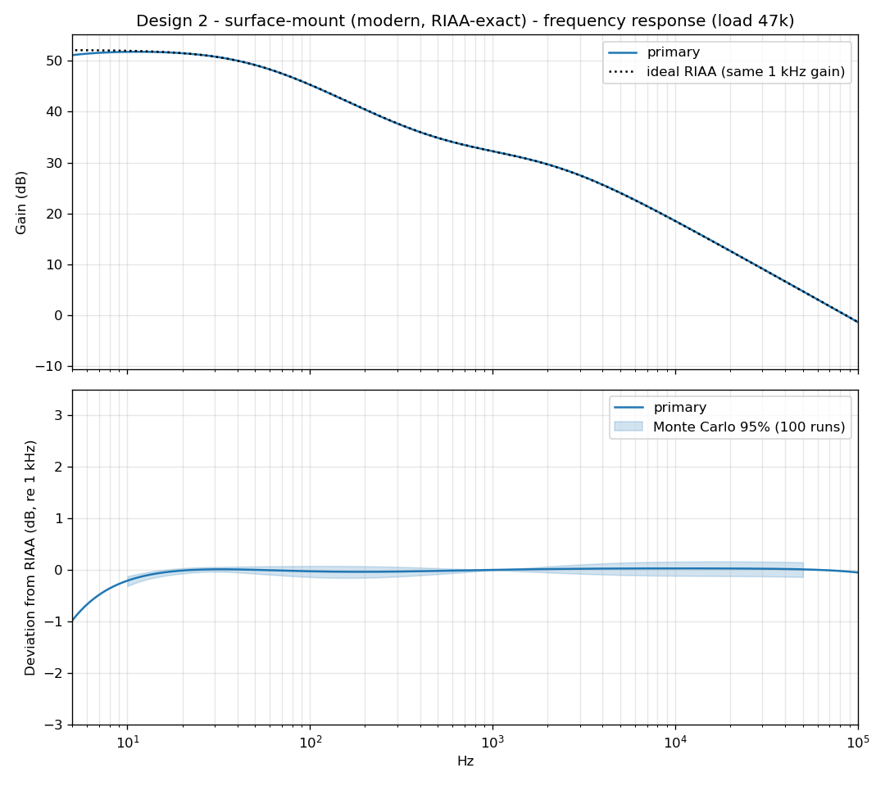
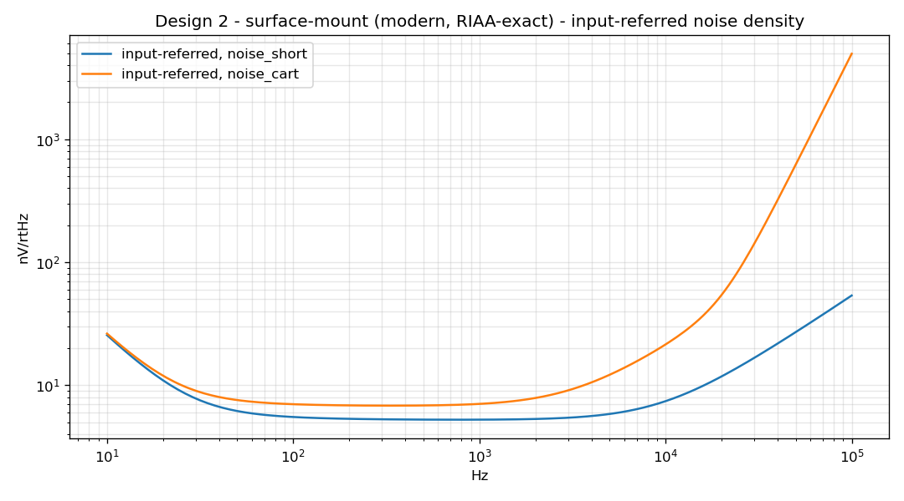
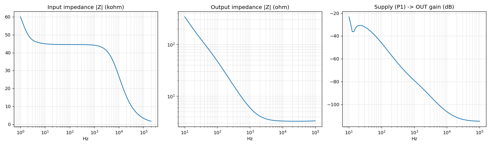
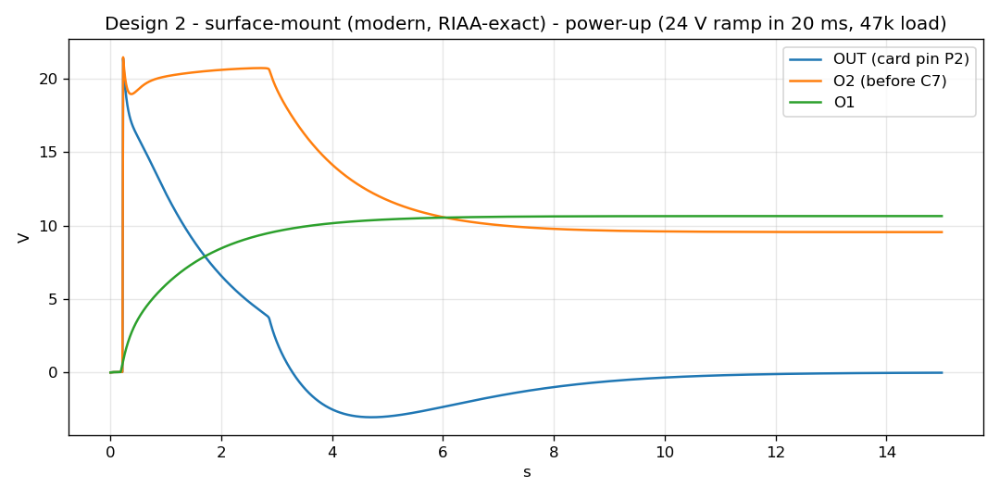

# Simulation results - Design 2 - surface-mount (modern, RIAA-exact)

Generated by `tools/simulate.py smd` (ngspice). All netlists are in `netlists/` and can be re-run with `ngspice -b <file>.cir` from that directory.

Assumptions: load 47 kohm on OUT (NAC82 selector input impedance not yet measured), cartridge 1000 ohm + 0.5 H, ideal 24 V at P1. Transistor models are representative, see `netlists/models.lib`.

## Headline figures

| Parameter | Value |
|---|---|
| Gain @ 1 kHz | 32.23 dB (x40.9) |
| RIAA deviation 20 Hz-20 kHz (max abs) | 0.04 dB |
| RIAA deviation 50 Hz-20 kHz (max abs) | 0.04 dB |
| Input impedance @1 kHz / 20 kHz | 44.2 k / 15.6 k |
| Output impedance @1 kHz | 5.9 ohm |
| Supply current | 20.2 mA |
| SNR re 5 mV @1 kHz, A-wtd, 1k+500mH source | 78.1 dB |
| SNR re 5 mV @1 kHz, A-wtd, shorted input | 84.0 dB |
| EIN @1 kHz, shorted input | 5.25 nV/rtHz |
| THD @1 kHz, 5 mV in | 0.0065 % |
| THD @1 kHz, 50 mV in | 0.0534 % |
| THD @20 kHz, 20 mV in | 0.0194 % |
| Overload (1 % THD) @20 Hz / 1 kHz / 20 kHz | 13.4 / 184 / 1749 mV rms |
| Overload margin re 5 mV @1 kHz | 31.3 dB |
| PSRR (P1 -> OUT) 100 Hz / 1 kHz / 10 kHz | -46.1 / -78.9 / -106.3 dB |
| Power-up: peak at OUT (47k load) / settles within 50 mV after | 21.38 V / 13.3 s |
| Monte Carlo (100 runs, R 0.1%, C 2%, electrolytic 20%, hFE x0.75..1.4): 95th pct max RIAA error | 0.16 dB |
| Monte Carlo gain spread @1 kHz | 32.17 .. 32.29 dB |

## Frequency response / RIAA deviation by value set

| Value set | Gain@1k | 10 Hz | 20 Hz | 50 Hz | 100 Hz | 10 kHz | 20 kHz | 50 kHz |
|---|---|---|---|---|---|---|---|---|
| primary | 32.23 dB | -0.21 | -0.01 | +0.00 | -0.03 | +0.03 | +0.03 | +0.01 |

(deviation from ideal RIAA in dB, normalised at 1 kHz)

## DC operating point (25 C)

| Node | V |
|---|---|
| V24 | 24.000 |
| VCC | 22.629 |
| B1 | 11.297 |
| B1A | 11.297 |
| E1 | 10.714 |
| N1 | 21.428 |
| E2 | 22.061 |
| N2 | 11.342 |
| O1 | 10.653 |
| Y1 | 1.268 |
| Z1 | 0.630 |
| B6 | 10.652 |
| E6 | 10.071 |
| N6 | 21.481 |
| E7 | 22.111 |
| N7 | 10.248 |
| O2 | 9.560 |
| Y2 | 1.268 |
| Z2 | 0.629 |
| F2 | 10.036 |
| OUT | 0.000 |
| B3 | 11.290 |
| B8 | 10.197 |
| C3P | 10.714 |
| C5P | 10.071 |

| Transistor | Ic (mA) | Vce (V) | Vbe (V) | Pd (mW) |
|---|---|---|---|---|
| Q1 | 0.056 | 10.71 | 0.583 | 0.6 |
| Q2 | -0.567 | -10.72 | -0.633 | 6.1 |
| Q3 | 9.098 | 11.98 | 0.637 | 109.0 |
| Q4 | 0.291 | 1.27 | 0.630 | 0.4 |
| Q5 | 9.205 | 10.02 | 0.638 | 92.3 |
| Q6 | 0.053 | 11.41 | 0.581 | 0.6 |
| Q7 | -0.517 | -11.86 | -0.630 | 6.1 |
| Q8 | 9.145 | 13.07 | 0.637 | 119.5 |
| Q9 | 0.291 | 1.27 | 0.629 | 0.4 |
| Q10 | 9.204 | 8.93 | 0.638 | 82.2 |

Temperature drift: 0 C: O1=10.54 V, O2=9.19 V, Isup=21.5 mA, 60 C: O1=10.79 V, O2=10.01 V, Isup=18.5 mA

## Distortion (1 kHz)

| Input | Output (V rms) | THD (%) |
|---|---|---|
| 2mV | 0.082 | 0.0044 |
| 5mV | 0.204 | 0.0065 |
| 10mV | 0.408 | 0.0112 |
| 20mV | 0.815 | 0.0214 |
| 50mV | 2.038 | 0.0534 |
| 20kHz_20mV | 0.085 | 0.0194 |

## Noise

| Source | Out noise 20-20k (uV) | A-wtd (uV) | SNR unwtd | SNR A-wtd |
|---|---|---|---|---|
| noise_short | 23.4 | 12.9 | 78.8 dB | 84.0 dB |
| noise_cart | 36.2 | 25.4 | 75.0 dB | 78.1 dB |

